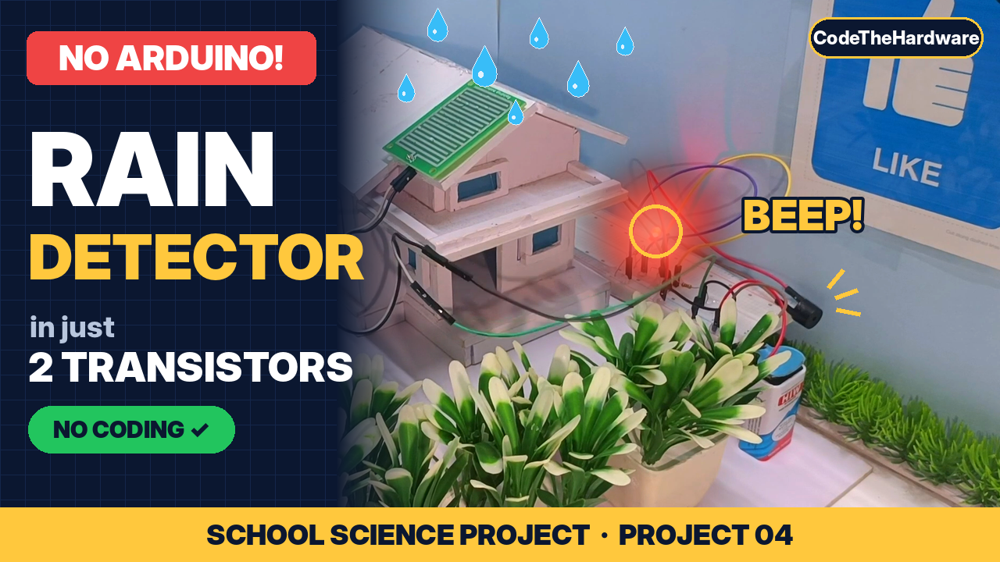
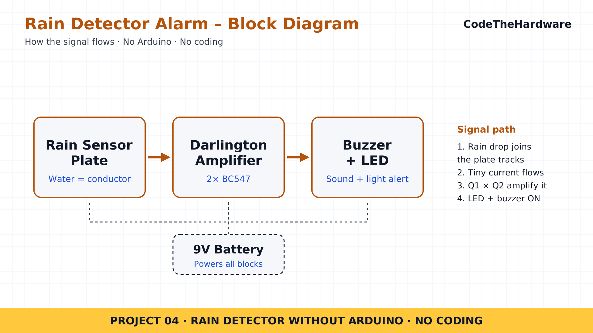
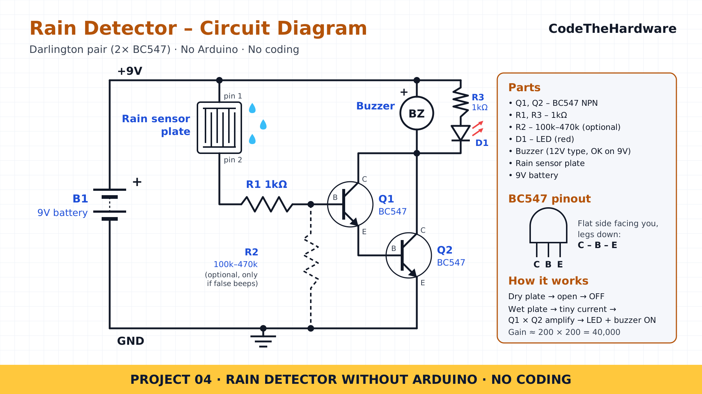

# Rain Detector Alarm using Transistors (No Arduino, No Coding)

A simple **rain detector alarm** built with **2× BC547 transistors** in a Darlington pair.
When rain falls on the sensor plate, the **LED glows and the buzzer beeps**. When the plate dries, the alarm stops.
A safe **9V school science / exhibition project** – no microcontroller, no programming.

▶️ **Full build video:** https://youtu.be/g0FPl0VcvvQ
📄 **Project report (PDF):** [docs/Rain_Detector_Project_Report.pdf](docs/Rain_Detector_Project_Report.pdf) – aim, materials, block diagram, circuit, working, procedure, observation table, applications, viva Q&A

## Block diagram

## Circuit diagram

## Components
| Component | Qty | Purpose |
|---|---|---|
| BC547 NPN transistor | 2 | Q1, Q2 – Darlington amplifier |
| 1kΩ resistor | 2 | R1 base protection, R3 LED current limit |
| 100k–470k resistor (optional) | 1 | R2 – only if it beeps when the plate is dry |
| Red LED | 1 | Light indication |
| Buzzer | 1 | Sound alert |
| Rain sensor plate | 1 | Detects water |
| 9V battery + snap | 1 | Power |
| Breadboard + jumper wires | 1 set | Connections |

## Connections
| From | To |
|---|---|
| Rain plate pin 1 | +9V |
| Rain plate pin 2 | 1kΩ (R1) → Q1 Base |
| Q1 Emitter | Q2 Base |
| Q1 Collector + Q2 Collector | Buzzer (−) and LED (−) |
| Buzzer (+) | +9V |
| +9V | 1kΩ (R3) → LED (+) |
| Q2 Emitter | GND |
| R2 (optional) | Q1 Base → GND |

**BC547 pins:** flat side facing you, legs down → **C – B – E** (left to right).

## How it works
- **Dry plate:** tracks are open → no base current → both transistors OFF → LED and buzzer OFF (almost zero battery use).
- **Wet plate:** water connects the tracks → a very small current (microamps) flows into Q1's base.
- **Why 2 transistors?** One BC547 gives a current gain of about 200 – not enough for such a tiny current. In a **Darlington pair** the gains multiply: about 200 × 200 ≈ 40,000 (typical), so Q2 switches fully ON and drives the buzzer and LED.

## Industry tips
- **Corrosion:** plain DC through water causes electrolysis, so the plate tracks corrode over weeks. Real level/rain sensors use stainless or gold-plated probes and **pulsed or AC excitation** (voltage applied only for short moments).
- **Standby current:** a good battery product is designed so it draws almost nothing while waiting. Here both transistors are OFF when dry, so no ON/OFF switch is really needed.
- **Transistor limit:** BC547 handles max 100 mA collector current. The buzzer (~20–30 mA) + LED (~7 mA) is well within that. For a motor or relay, use a relay/driver – don't drive it directly.

## Safety
- Use only a **9V battery**. Never connect this circuit to 230V mains.
- Keep water away from the battery and breadboard – only the rain plate should get wet.
- Students: build with a parent or teacher.

## Next version
Automatic clothes protector with **Arduino + DC motor + limit switches** – coming soon on the channel.

---
🔔 YouTube: [@CodeTheHardware](https://www.youtube.com/@CodeTheHardware) · 📧 Project help: codethehardware@gmail.com

License: MIT
